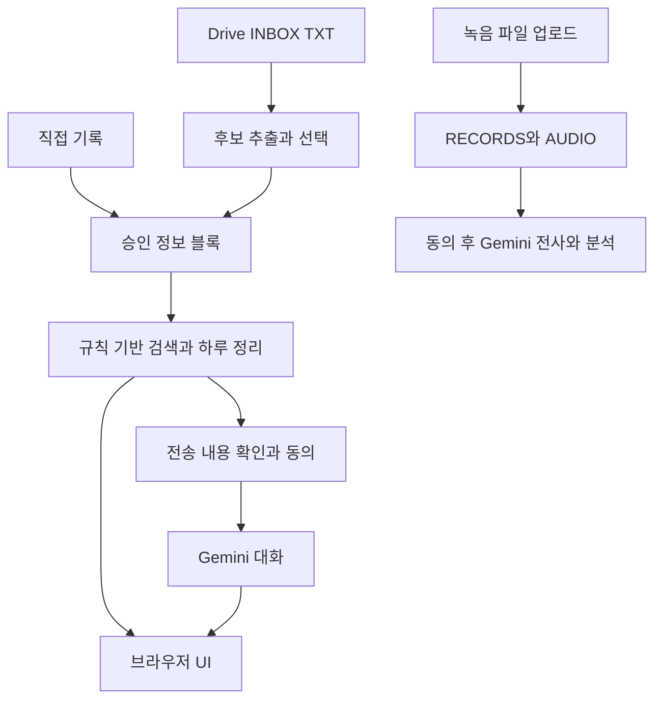

# 아키텍처: 현재 GAS 알파와 장기 설계

## 1. 현재 실행 구조

블록·RECORDS·AUDIO는 모두 개인 Google Drive에 저장한다. Gemini 호출을 하지 않는 경로도 GAS와 Drive를 사용하므로 온디바이스 구조가 아니다. 녹음 전사·분석의 RECORDS 경로와 현재 검색·하루 상담의 BLOCKS 경로는 분리되어 있다. 양자를 자동으로 연결하는 화살표를 그리지 않았다.

## 2. 모듈별 책임

| 모듈 | 역할 |
|---|---|
| `src/Code.gs` | 소유자 확인, 초기 폴더 설정, 웹 UI 진입, 상태 조회 |
| `src/Database.gs` | Drive JSON 접근, 기존 RECORDS CRUD 보조, 내보내기 |
| `src/Blocks.gs` | 월별 블록 DB, TXT 해석, 대기 목록, 후보 승인·정정·삭제 |
| `src/MemoryService.gs` | 이전 기록 경로, TXT 스캔·트리거, 프로필 제안·승인 |
| `src/Assistant.gs` | 외부 AI 없는 검색, 시간 범위·작업 상태, 지금 화면·저녁 정리 |
| `src/ChatService.gs` | Gemini 요청, 외부 AI 스위치, 동의·텍스트 가림 검사, 분석 |
| `src/AudioService.gs` | 원음 업로드, 전사, 전사 후 분석 |
| `src/Counsel.gs` | 날짜별 상담 미리보기, 다회 대화, 상담 규칙 결합 |
| `src/Index.html` | 대화·검색·저녁 정리·내 정보·하루 상담 UI, 자막·음성·모리 |
| `scripts/build-knowledge.mjs` | 문서와 캐릭터를 GAS 문자열 파일로 생성 |
| `tests/run.mjs` | Google 서비스·AI 응답을 대체한 모의 검사 |

## 3. 처리 경계

TXT의 자동 스캔은 새 파일을 발견해 승인 대기로 등록하는 단계다. 사용자가 후보를 고르기 전에는 정보 블록을 저장하지 않는다. 원본 TXT는 INBOX에 남는다. 승인한 후보는 가림 처리를 거쳐 BLOCKS에 저장된다.

검색은 규칙 기반이다. 일부 조사 제거·불용어·날짜 범위·계획/완료 패턴을 사용한다. 임베딩 DB나 학습된 한국어 의미 검색 엔진을 사용하지 않는다. `askLocal`의 local은 외부 생성 AI를 호출하지 않는다는 의미다.

상담은 사용자가 확인한 하루 기록을 맥락으로 사용한다. 후속 요청에는 승인 맥락과 최근 대화 최대 16개, 새 발화를 보낸다. 서버는 상담 대화 전체를 자동 저장하지 않는다. 전송되는 내용은 사용자 기록뿐 아니라 상담 규칙·캐릭터·프로젝트 원칙 문서도 포함한다.

## 4. 장기 로컬 우선 방향

기기 내 수집·전사 → 개인 영역에서 사건 추출과 민감정보 분리 → 외부 전송 게이트 → 허용된 최소 정보만 외부 AI → 검증한 결과를 출처별로 저장하는 구조를 지향한다.

이전 Python/SQLite/FTS·FastAPI·Markdown/YAML 안은 로컬 우선 방향의 선행 프로토타입/설계 이력이다. 현재 GAS 저장소의 런타임과 혼합해 적지 않는다. 로컬 이전 시에는 접근 권한, 원문 보유기간, 사용자 교정, 이력 이전을 함께 설계해야 한다.

## 5. 현재 기술 부채

- 월별 JSON도 조회 시 여러 파일을 읽는다. 장기 누적 규모와 응답시간은 측정 전이다.
- 문장 후보는 규칙 추출이라 중요한 발화를 놓칠 수 있다.
- 전사 타임코드는 발화 시점이다. “어제 다녀왔다”라는 발화의 실제 사건 시점과 같지 않다.
- RECORDS와 BLOCKS를 통합하지 않은 상태에서 전사 완료를 상담 사용 가능과 동일시하면 안 된다.
- 지침 문서를 프롬프트에 포함하는 방식은 문서 최신성·길이·충돌을 관리해야 한다. RAG나 지식 그래프 구현으로 소개하지 않는다.
