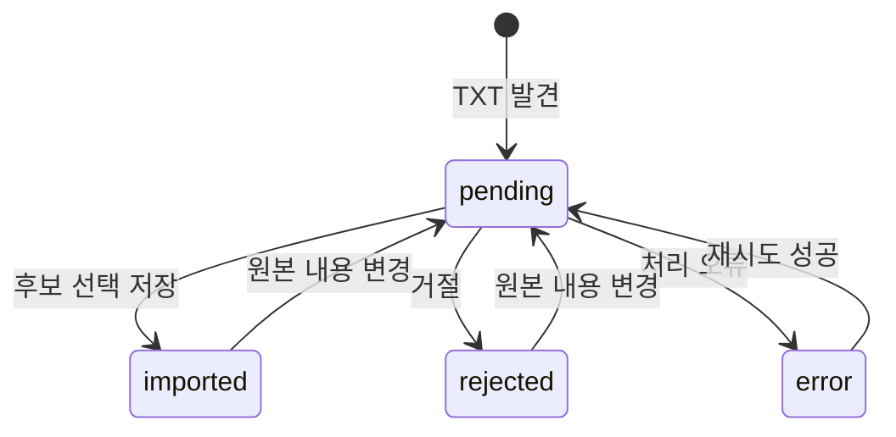

# 데이터와 기록의 의미

## 1. 저장 위치

| 구역 | 내용 | 주의 |
|---|---|---|
| INBOX | 사용자가 업로드한 TXT 원본 | 블록 삭제와 별개로 남음 |
| BLOCKS | `blocks-YYYY-MM.json` 정보 블록 | 현재 검색·하루 정리의 주 데이터 |
| SYSTEM | TXT 스캔 등록부와 처리 로그 | 파일 ID·해시·상태 관리 |
| RECORDS | 기존 직접 기록·음성 전사·분석 JSON | BLOCKS와 별도 경로 |
| AUDIO | 업로드 원음 | 전사 시 외부 전송 가능 |
| PROFILE | 승인된 자기정보·변경 제안·이력 | 제안과 채택값 구분 |

## 2. 실제 블록 필드

| 필드 | 의미 |
|---|---|
| `id` | 생성 월과 해시를 포함하는 식별자 |
| `kind`, `text` | note/plan/done/summary/answer 등 유형과 내용 |
| `speaker` | 원문 화자 표기. 본인 식별 보증 아님 |
| `people`, `places`, `timeText` | 규칙 추출한 인물·장소·시각 표현 |
| `occurredAt`, `timeSource` | 저장된 시각과 근거. 전사에서는 녹음 시작+발화 오프셋일 수 있음 |
| `recordedAt`, `createdAt` | 기록/생성 시점. 실제 사건 발생시점과 구별 필요 |
| `sourceType`, `source` | 진술/전사/기기 요약/저녁 응답 구분 및 출처 |
| `task` | 계획의 open/done/dropped 상태, 변경시각·사용자 표기 |
| `revision`, `history` | 버전과 변경 이력 |
| `deleted` | 삭제 표식. 삭제 시 본문과 이력 제거 |

초기 설계에는 신뢰도 필드도 제안했으나, 현재 블록 모델에 보정된 확률 신뢰도 점수는 없다. 알고리즘의 추출 결과를 확정 사실로 해석하지 않는다.

## 3. 출처 계층

직접 진술은 사용자가 그렇게 말했다는 기록이지, 내용의 객관적 진실을 자동 보장하지 않는다. `imported_transcript`는 인식 오류가 있을 수 있고, `device_ai_summary`는 자동 생성 요약이다. 기기 요약 후보는 기본 선택 해제되어 있다. AI 분석은 RECORDS의 `ai_inference`로 원문과 분리한다.

## 4. 상태 변화

위 도식은 개념적 처리 흐름이다. 실제 오류 재시도 횟수·파일 변경 판정은 `scanInbox_` 구현을 따른다. 오류는 최대 3회 재시도하도록 구현돼 있다.

작업 상태는 open, done, dropped이며 사용자의 명시적 조작으로 바꾼다. 자동 추출한 별도 ‘완료 발화’와 기존 계획의 상태 변경은 같은 기능이 아니다. 의미상 같은 사건을 자동 병합하는 기능으로 소개하지 않는다.

## 5. 정정·삭제의 한계

정정에는 버전 검사를 사용한다. 동시에 오래된 화면에서 수정하면 충돌을 알린다. 다만 본문 교정 후 기존 인물·장소·유형 등의 파생 필드가 함께 재계산되는지는 추가 개선 대상이다.

블록 삭제는 본문·이력을 제거하고 식별 표식을 남긴다. RECORDS의 음성 기록 삭제는 원음을 Drive 휴지통으로 이동시킨다. INBOX TXT, 이미 내보낸 사본, 제공업체 측 처리까지 영구 삭제하는 기능은 아니다. “완전 삭제”로 소개하지 않는다.

## 6. 향후 모델 개선 제안

발화시각·기록시각·사건시각을 별도 필드로 다루고, 원문 구간 식별자와 사용자 확인 상태를 분리하는 개선이 필요하다. 화자가 본인인지 확인한 상태, AI 추정의 검토 상태, 이전/새 선호의 공존도 후속 설계 후보다. 이는 이번 문서 정리에서 새로 구현한 기능이 아니다.
